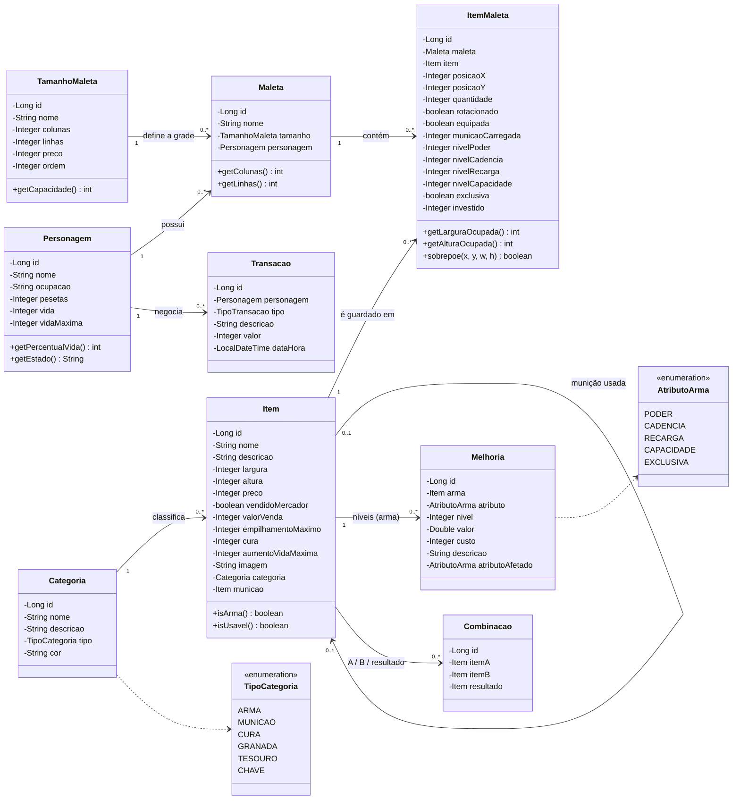
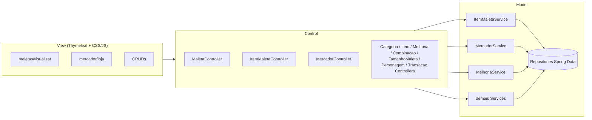
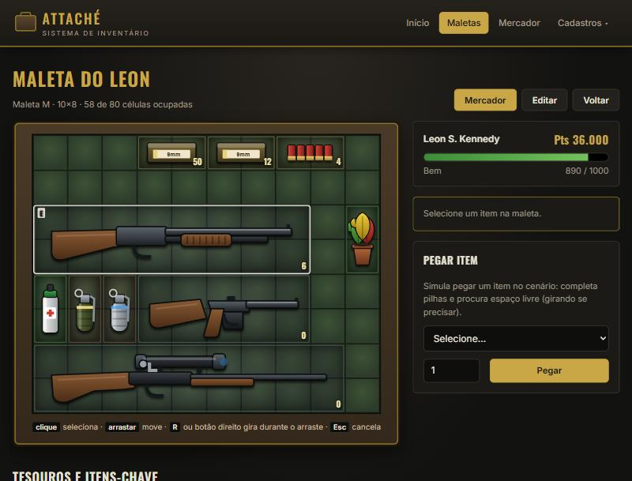
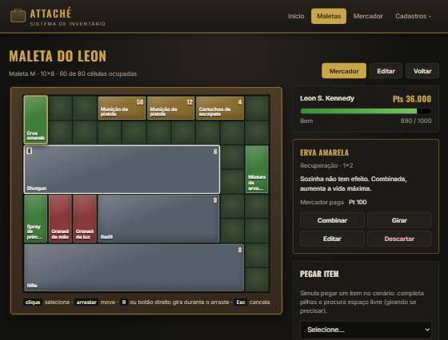
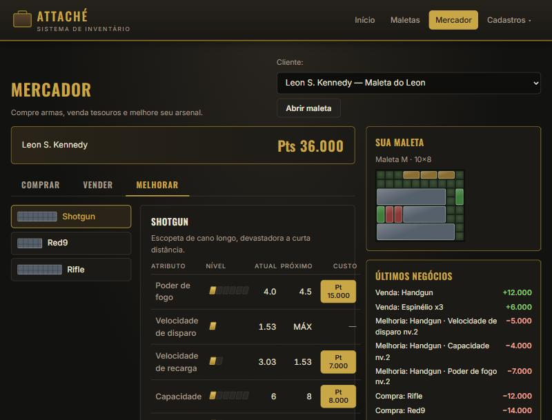

# Atividade – Sistema WEB · 1ª Etapa

## 1. Tema do sistema

**Maleta – Sistema de Inventário**, baseado no inventário e no mercador de
*Resident Evil 4* (2005).

O personagem carrega uma **maleta em grade**. Cada item ocupa um retângulo de células
(pistola 3×2, escopeta 8×2, erva 1×2...) e pode ser **girado 90°** para caber melhor. Um
**mercador** compra e vende itens em **pesetas (₧)**, vende maletas maiores e faz **melhorias
nas armas** (poder de fogo, velocidade de disparo, velocidade de recarga, capacidade e uma
melhoria exclusiva).

### Mecânicas implementadas

| Mecânica | Como funciona | Onde |
|---|---|---|
| Grade da maleta | Item não pode sair da grade nem ficar sobre outro | `ItemMaletaService.mover / salvar` |
| Arrastar e soltar | Move o item com o mouse; **R** ou botão direito gira durante o arraste | `app.js` + `ItemMaletaService.mover` |
| Girar 90° | Troca largura e altura, se couber | `ItemMaletaService.rotacionar` |
| Pegar item | Completa pilhas iguais e procura o 1º espaço livre (girando se precisar) | `ItemMaletaService.adicionar` |
| Empilhar | Munição empilha até o limite por espaço; combinar pilhas iguais junta | `ItemMaletaService.combinar` |
| Combinar ervas | V+V, V+Vm, V+A, Vm+A, V+V+V, V+Vm+A (receitas cadastráveis) | `Combinacao` + `ItemMaletaService.combinar` |
| Usar | Cura vida (ou toda a vida) e aumenta a vida máxima (erva amarela) | `ItemMaletaService.usar` |
| Equipar | Uma arma/granada equipada por vez | `ItemMaletaService.equipar` |
| Recarregar | Puxa a munição certa da maleta até a capacidade da arma (ou combine munição + arma) | `ItemMaletaService.recarregar` |
| Tesouros e itens-chave | Não ocupam a grade; ficam numa lista própria | `TipoCategoria.ocupaMaleta` |
| Mercador – Comprar | Só compra com pesetas suficientes e espaço na maleta | `MercadorService.comprar` |
| Mercador – Vender | Arma vende por ½ do investido (preço + melhorias); tesouros pelo valor | `MercadorService.vender / valorVenda` |
| Mercador – Melhorar | Sobe 1 nível por vez; exclusiva só com tudo no máximo | `MercadorService.melhorar` |
| Mercador – Maletas | Troca por uma maior (P 10×6 → M 10×8 → G 13×8 → GG 13×9); itens ficam no lugar | `MercadorService.comprarMaleta` |
| Histórico | Toda compra/venda/melhoria é registrada | `TransacaoService` |
| Imagens dos itens | Ícone desenhado para cada item, girando junto na grade; upload de imagem própria no cadastro | `ImagemService` + `imagens.css` |

> Os números das armas (preços, níveis e valores) são aproximados e podem ser ajustados
> pelos cadastros de **Itens** e **Melhorias de armas**.

**Tecnologias:** Java 17+, Spring Boot 3 (Spring MVC, Spring Data JPA, Bean Validation),
Thymeleaf, HTML/CSS/JS, banco relacional H2 (arquivo) ou MySQL.

---

## 2. Diagrama de classes (entidades)

### Arquitetura MVC

> Os **Controllers nunca acessam Repository** – sempre passam pelos Services.

---

## 3. Diagrama MER

```mermaid
erDiagram
    PERSONAGEM ||--o{ MALETA : possui
    TAMANHO_MALETA ||--o{ MALETA : "define a grade"
    MALETA ||--o{ ITEM_MALETA : contem
    ITEM ||--o{ ITEM_MALETA : "guardado em"
    CATEGORIA ||--o{ ITEM : classifica
    ITEM |o--o{ ITEM : "municao usada"
    ITEM ||--o{ MELHORIA : "niveis da arma"
    ITEM ||--o{ COMBINACAO : "item A / item B / resultado"
    PERSONAGEM ||--o{ TRANSACAO : negocia

    PERSONAGEM {
        BIGINT id PK
        VARCHAR nome
        VARCHAR ocupacao
        INT pesetas
        INT vida
        INT vida_maxima
    }
    TAMANHO_MALETA {
        BIGINT id PK
        VARCHAR nome UK
        INT colunas
        INT linhas
        INT preco
        INT ordem
    }
    MALETA {
        BIGINT id PK
        VARCHAR nome
        BIGINT tamanho_id FK
        BIGINT personagem_id FK
    }
    CATEGORIA {
        BIGINT id PK
        VARCHAR nome UK
        VARCHAR descricao
        VARCHAR tipo
        VARCHAR cor
    }
    ITEM {
        BIGINT id PK
        VARCHAR nome
        VARCHAR descricao
        INT largura
        INT altura
        INT preco
        BOOLEAN vendido_mercador
        INT valor_venda
        INT empilhamento_maximo
        INT cura
        INT aumento_vida_maxima
        VARCHAR imagem
        BIGINT categoria_id FK
        BIGINT municao_id FK
    }
    MELHORIA {
        BIGINT id PK
        BIGINT arma_id FK
        VARCHAR atributo
        INT nivel
        DOUBLE valor
        INT custo
        VARCHAR descricao
        VARCHAR atributo_afetado
    }
    COMBINACAO {
        BIGINT id PK
        BIGINT item_a_id FK
        BIGINT item_b_id FK
        BIGINT resultado_id FK
    }
    ITEM_MALETA {
        BIGINT id PK
        BIGINT maleta_id FK
        BIGINT item_id FK
        INT posicao_x
        INT posicao_y
        INT quantidade
        BOOLEAN rotacionado
        BOOLEAN equipada
        INT municao_carregada
        INT nivel_poder
        INT nivel_cadencia
        INT nivel_recarga
        INT nivel_capacidade
        BOOLEAN exclusiva
        INT investido
    }
    TRANSACAO {
        BIGINT id PK
        BIGINT personagem_id FK
        VARCHAR tipo
        VARCHAR descricao
        INT valor
        TIMESTAMP data_hora
    }
```

São **9 tabelas**. Maleta e Item têm relação N:N resolvida por **item_maleta**, que guarda
também o estado de cada item na maleta (posição, rotação, quantidade e, para armas, os níveis
de melhoria, a munição carregada e o valor investido). O script SQL está em [`schema.sql`](schema.sql).

---

## 4. Protótipos de tela

As telas já estão implementadas em Thymeleaf (`src/main/resources/templates`).

| Tela | URL | Descrição |
|---|---|---|
| Início | `/` | Totais e atalhos para as maletas |
| Inventário (maleta) | `/maletas/{id}` | Grade com arrastar/soltar, painel do item (Usar, Equipar, Recarregar, Combinar, Girar, Descartar), vida, pesetas, tesouros |
| Mercador | `/mercador/{maletaId}` | Abas Comprar / Vender / Melhorar, compra de maletas, histórico |
| Maletas | `/maletas` | CRUD (nome, dono, tamanho) |
| Itens | `/itens` | CRUD com tamanho na grade, preços, munição, cura |
| Melhorias de armas | `/melhorias` | CRUD da tabela de níveis/preços |
| Combinações | `/combinacoes` | CRUD das receitas |
| Categorias / Tamanhos / Personagens | `/categorias`, `/tamanhos`, `/personagens` | CRUDs |
| Itens nas maletas | `/guardados` | CRUD da tabela associativa |
| Histórico | `/transacoes` | Listagem e exclusão |

| Inventário | Item selecionado | Mercador – Melhorar |
|---|---|---|
|  |  |  |
